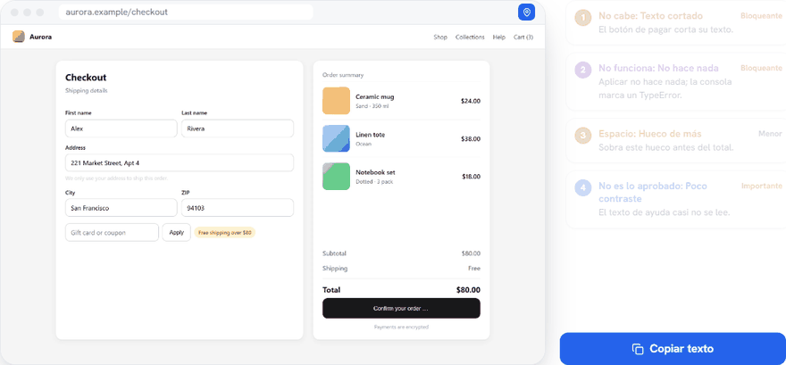
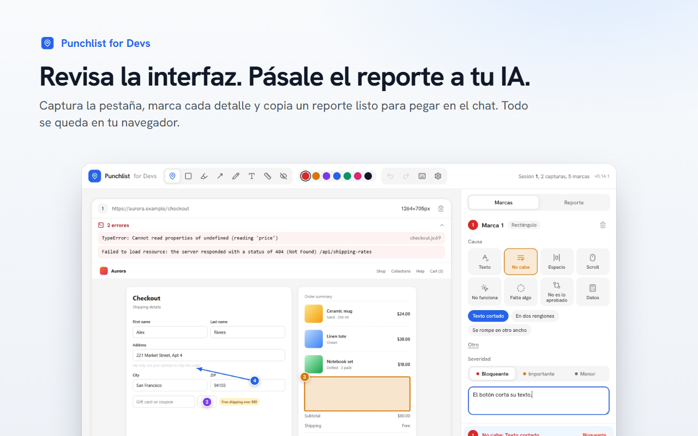
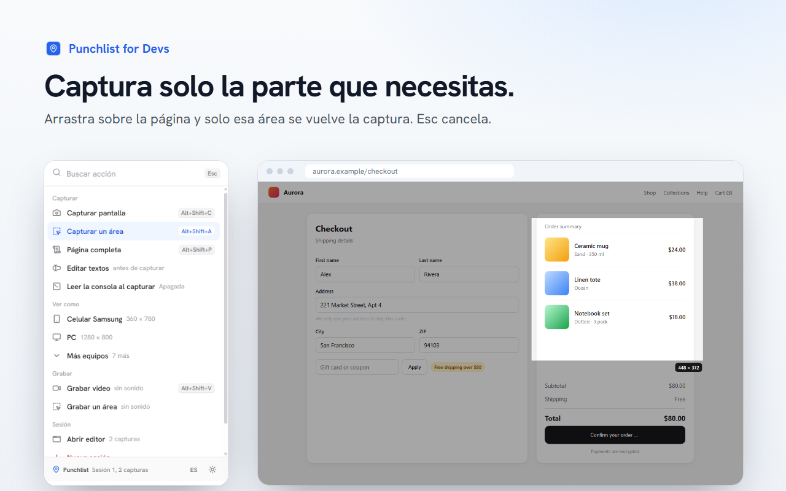
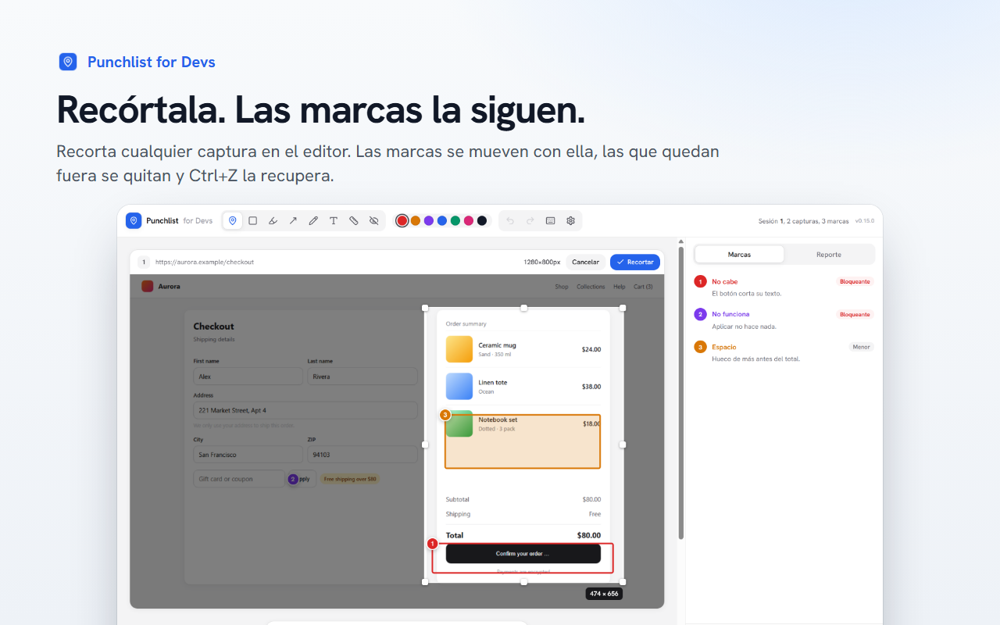
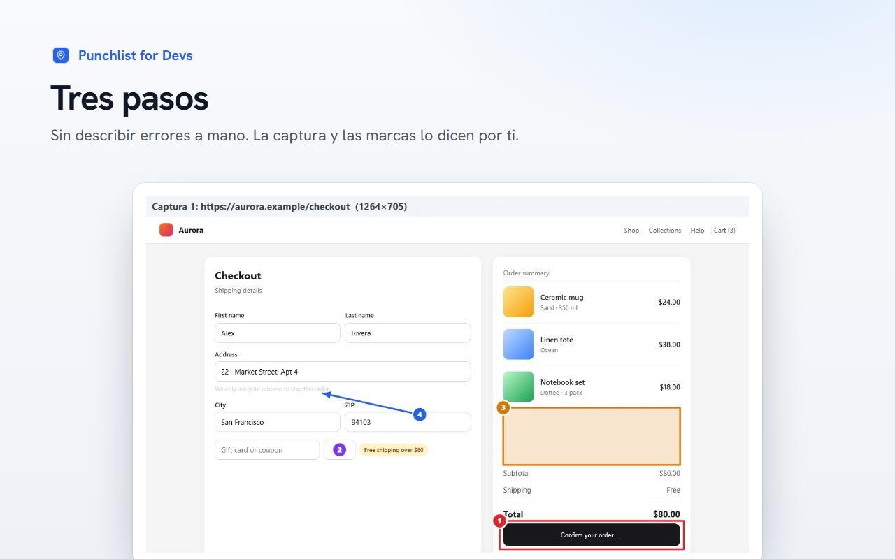
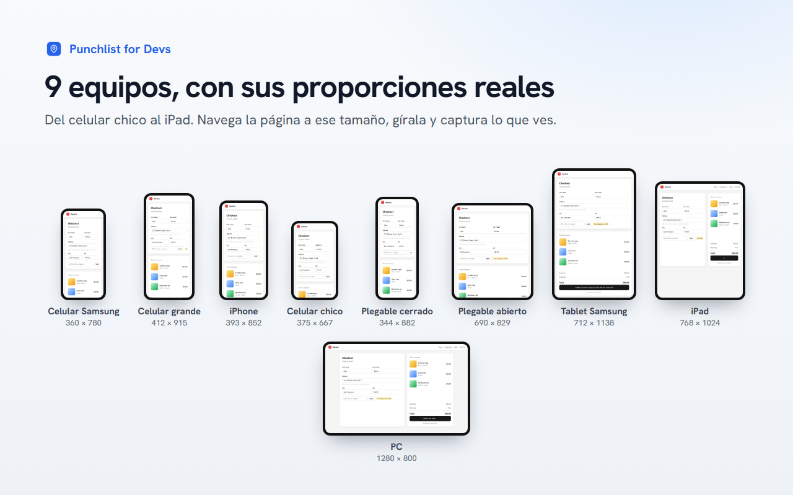
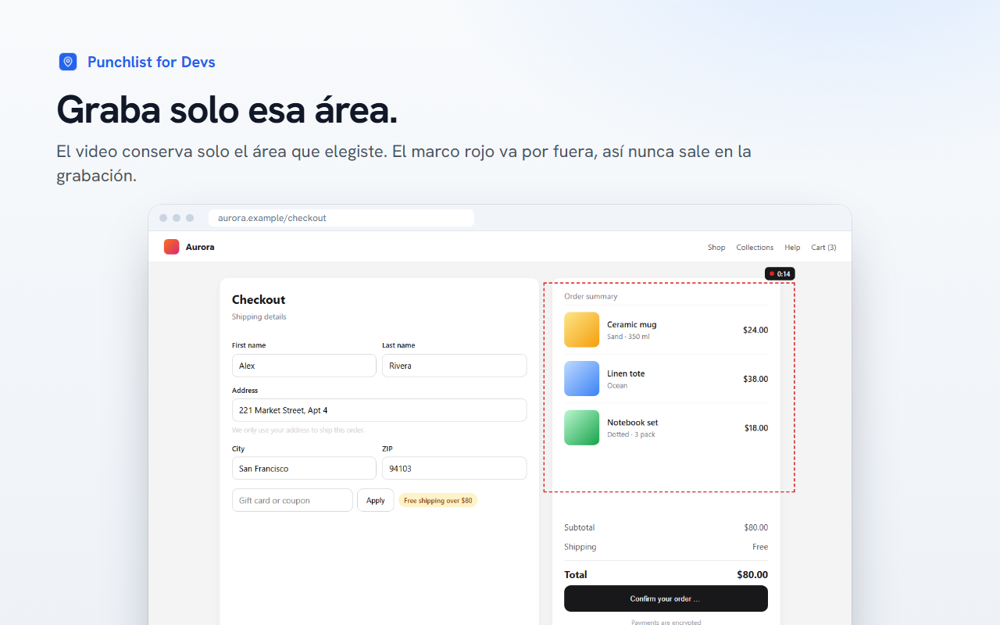
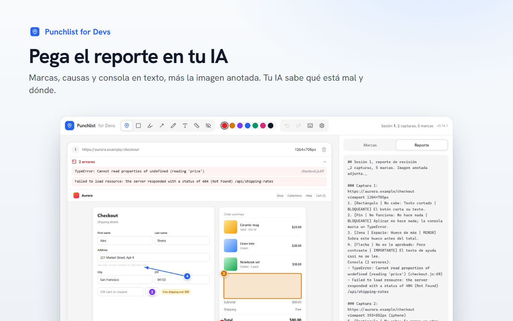

[English](README.md) | **Español** | [Français](README.fr.md)

# Punchlist for Devs

**Revisa la interfaz. Pásale el reporte a tu IA.**

Captura la pestaña, marca cada detalle y copia un reporte listo para pegar en Claude, ChatGPT, Cursor o un issue. 
Todo se queda en tu navegador.

[Sitio](https://usepunchlist.vercel.app) | [Privacidad](https://usepunchlist.vercel.app/privacidad) | [Reportar un bug](../../issues/new?template=bug_report.yml) | [Pedir una función](../../issues/new?template=feature_request.yml)

 

## Por qué

Describir un bug de interfaz con palabras es lento, y tu IA igual adivina dónde está. Punchlist convierte la revisión
en algo que entiende a la primera: una **captura con marcas numeradas**, cada una con su **causa** y su
**severidad**, más los **errores de la consola** de la página, en texto y en una sola imagen anotada.

Sin cuentas, sin servidores, sin analítica. Tú decides qué copias y dónde lo pegas.

## Qué hace

<table>
<tr>
<td width="50%" valign="top">

### Captura lo que ves
La pestaña visible, la **página completa** (recorre sola paneles y modales y los cose) o **solo un área** que
arrastras sobre la página.

</td>
<td width="50%" valign="top">

### Marca cada detalle
Ocho herramientas: pin, rectángulo, zona, flecha, lápiz, texto, una **regla en px CSS** y una caja para tapar datos.
Cada marca lleva causa (no cabe, espacio, no funciona, falta…) y severidad.

</td>
</tr>
<tr>
<td valign="top">

### Revísala en 9 equipos
El modo dispositivo muestra la página como celular, plegable, tablet o PC, vertical u horizontal, y capturas
justo esa vista.

</td>
<td valign="top">

### Lee la consola
Opcional: cada captura trae los errores de JavaScript y los recursos que fallaron desde la anterior. Los correos,
tokens y llaves se tapan solos.

</td>
</tr>
<tr>
<td valign="top">

### Graba el bug
Graba la pestaña, o solo un área, en video. Convierte cualquier cuadro en captura y márcalo.

</td>
<td valign="top">

### Pásaselo a tu IA
**Copiar texto** da un reporte con cada marca, su causa, su severidad y la consola. **Copiar imagen** da una
hoja anotada. Pega las dos en el chat.

</td>
</tr>
</table>

## Más de cerca

## Cómo funciona

1. **Captura.** Pulsa el ícono de la extensión o un atajo en la página que estás revisando.
2. **Marca.** El editor se abre con tu captura. Elige una herramienta, dibuja y elige la causa y la severidad.
3. **Copia.** Pulsa **Copiar texto** y **Copiar imagen**, y pégalos en el chat de tu IA o en tu gestor de issues.

## Atajos de teclado

| Atajo | Qué hace |
|---|---|
| <kbd>Alt</kbd>+<kbd>Shift</kbd>+<kbd>C</kbd> | Capturar la pestaña visible |
| <kbd>Alt</kbd>+<kbd>Shift</kbd>+<kbd>A</kbd> | Capturar un área |
| <kbd>Alt</kbd>+<kbd>Shift</kbd>+<kbd>P</kbd> | Capturar la página completa |
| <kbd>Alt</kbd>+<kbd>Shift</kbd>+<kbd>V</kbd> | Grabar video, o detener la grabación |

El modo celular, el modo PC y *Grabar un área* no traen atajo: asígnales uno en `chrome://extensions/shortcuts`. En
el editor, <kbd>1</kbd> a <kbd>8</kbd> cambian de herramienta, <kbd>Ctrl</kbd>+<kbd>Z</kbd> deshace y <kbd>?</kbd>
muestra todos los atajos.

## Privacidad

Todo se queda en tu navegador. Las capturas, marcas y videos viven en `chrome.storage` e IndexedDB, en tu
computadora. La extensión **no envía ningún dato** al desarrollador ni a nadie más, no tiene cuentas, ni analítica,
ni publicidad. Lee el [aviso de privacidad](https://usepunchlist.vercel.app/privacidad) completo.

Para qué sirve cada permiso

| Permiso | Para qué |
|---|---|
| `activeTab` | Capturar la pestaña en la que usas la extensión. |
| `tabs` | Reusar la pestaña del editor y leer la URL y el título de la pestaña capturada para el reporte. |
| `scripting` | Recorrer y coser la página completa, mostrar el selector de área y activar el modo para editar textos. |
| `storage`, `unlimitedStorage` | Guardar la sesión, las capturas y las preferencias en tu equipo. Una página completa pesa varios MB. |
| `clipboardWrite` | **Copiar texto** y **Copiar imagen**. |
| `debugger` | El modo dispositivo (emula el tamaño de pantalla) y, solo si lo enciendes, leer la consola al capturar. |
| `tabCapture`, `offscreen` | Grabar en video la pestaña, o un área de ella. |

## Idiomas

Español, inglés y francés, con modo claro y oscuro. El idioma sigue al de tu navegador y se cambia desde el popup.

## Comentarios y colaboración

El código todavía no es público, pero hay muchas formas de ayudar:

- 🐞 **[Reporta un bug](../../issues/new?template=bug_report.yml)**: qué hiciste, qué esperabas y qué pasó.
- 💡 **[Pide una función](../../issues/new?template=feature_request.yml)**: cuéntanos qué te frena al revisar interfaces.
- 💬 **[Únete a las discusiones](../../discussions)**: ideas, preguntas y cómo la usas con tu IA.
- 🌍 **Mejora una traducción**, o propón un idioma nuevo, con un issue.
- 🤝 **¿Quieres colaborar en el código?** Abre una discusión y preséntate.

Puedes escribir en español, inglés o francés.

## Lo que viene

- Mover y cambiar de tamaño una marca ya dibujada.
- Ver el antes y el después de los textos editados sobre la captura.
- Ligar cada marca al elemento del DOM y su CSS calculado.
- Más revisiones automáticas: botones que se parten en dos renglones, poco contraste.

¿Tienes una idea que debería estar aquí? [Abre una discusión](../../discussions).

## Apoya el proyecto

Punchlist es gratis. Si te ahorra tiempo:

- ⭐ **Dale una estrella a este repo** para que más devs la encuentren.
- ✍️ **[Deja una reseña](https://chromewebstore.google.com/detail/punchlist-for-devs/gcffhkjonlkafgglgpfbpadoijjimeme/reviews)** en la Chrome Web Store.
- 📣 **Compártela** con tu equipo o en redes.
- ☕ **[Invítame un café](https://www.paypal.com/donate/?business=manuelceomx%40gmail.com&item_name=Punchlist%20for%20Devs&currency_code=USD)** con PayPal.

---

Hecho por **[Manuel Castellanos](https://manuelcastellanos.com.mx)** | [usepunchlist.vercel.app](https://usepunchlist.vercel.app)

Chrome y la insignia de Chrome Web Store son marcas de Google LLC.

