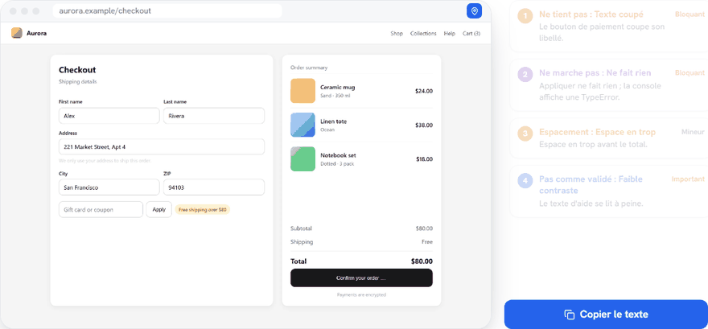
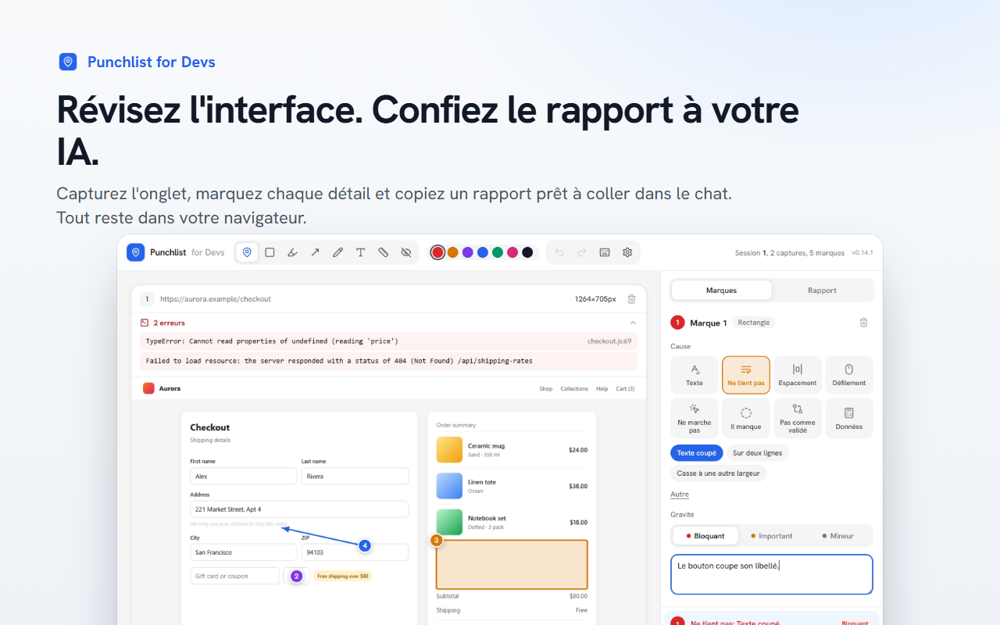
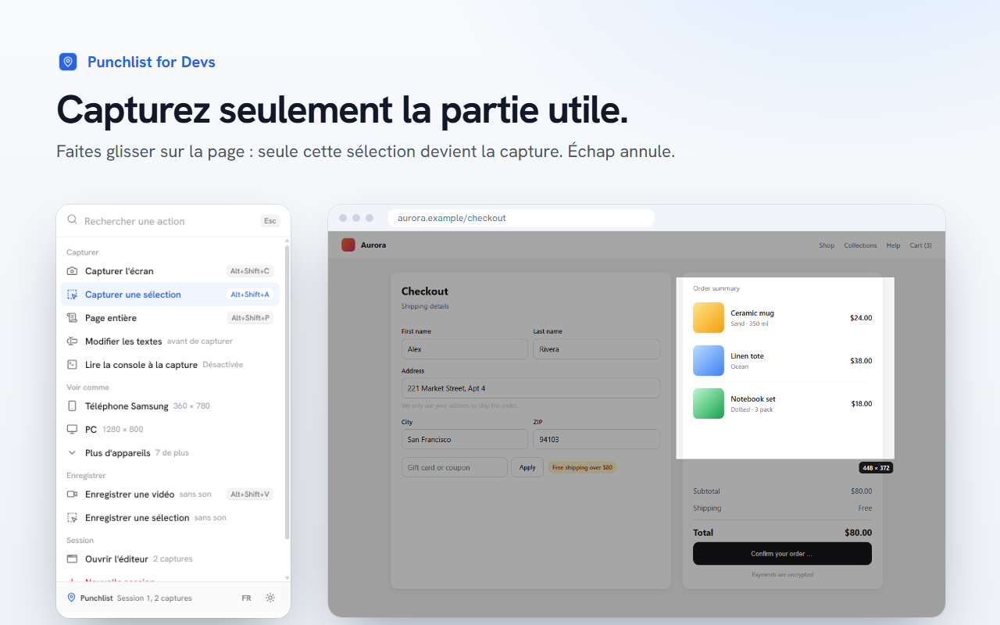
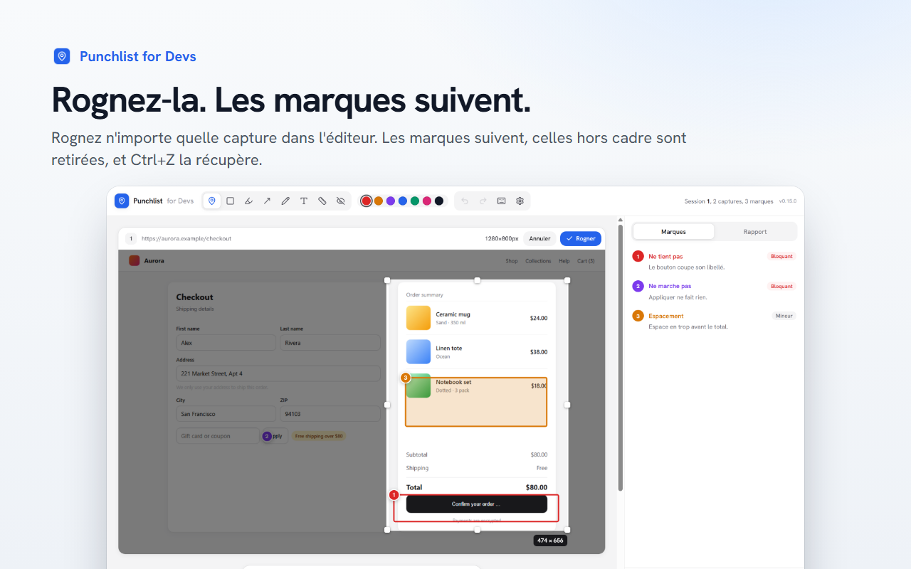
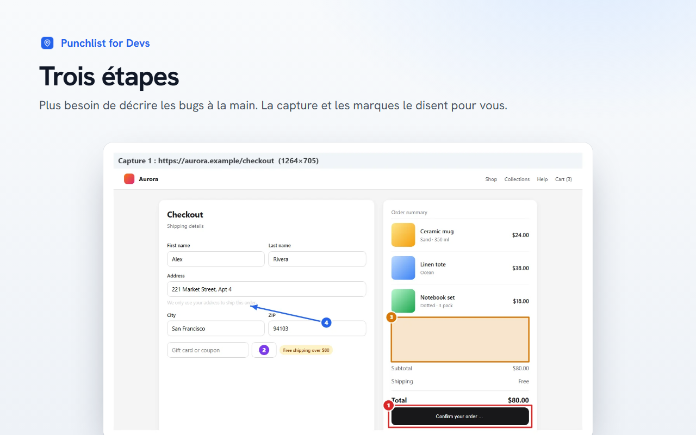
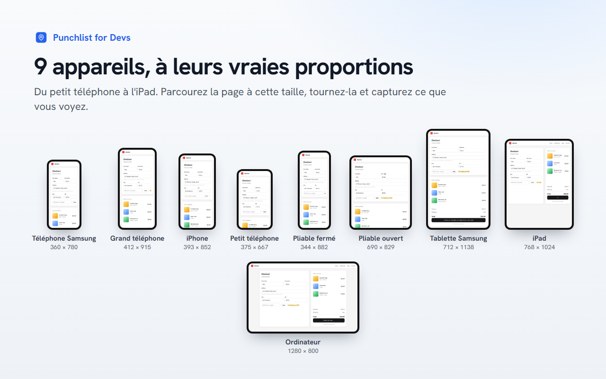
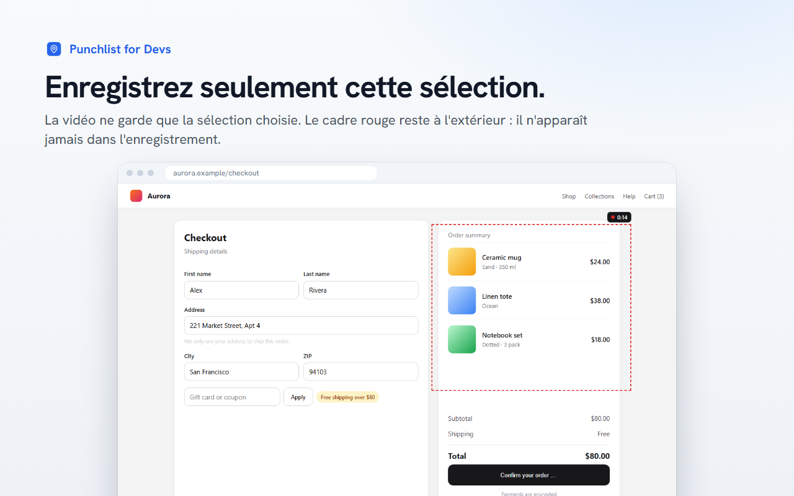
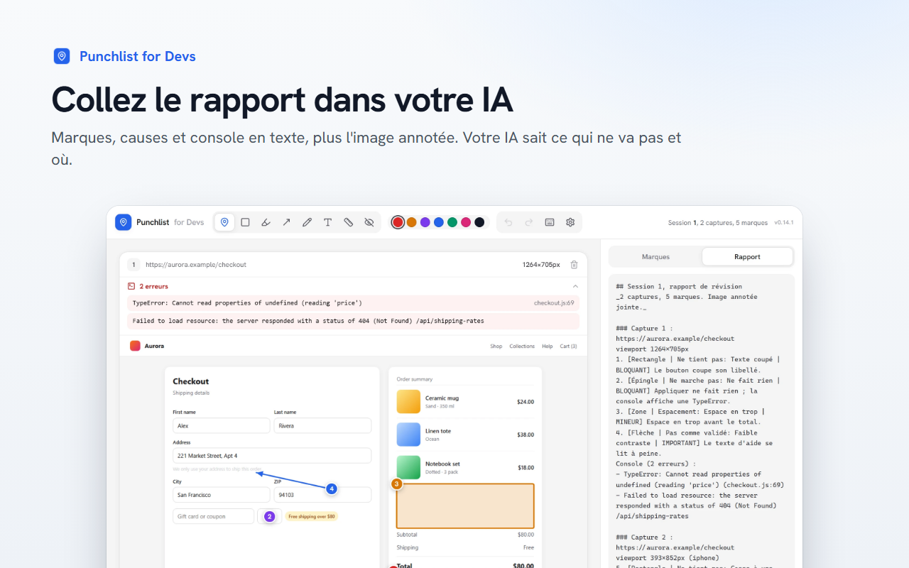

[English](README.md) | [Español](README.es.md) | **Français**

# Punchlist for Devs

**Révisez l'interface. Confiez le rapport à votre IA.**

Capturez l'onglet, marquez chaque détail et copiez un rapport prêt à coller dans Claude, ChatGPT, Cursor ou un ticket. 
Tout reste dans votre navigateur.

[Site](https://usepunchlist.vercel.app) | [Confidentialité](https://usepunchlist.vercel.app/privacidad) | [Signaler un bug](../../issues/new?template=bug_report.yml) | [Proposer une fonction](../../issues/new?template=feature_request.yml)

 

## Pourquoi

Décrire un bug d'interface avec des mots prend du temps, et votre IA doit encore deviner où il se trouve. Punchlist
transforme la révision en quelque chose qu'elle comprend du premier coup : une **capture avec des marques
numérotées**, chacune avec sa **cause** et sa **gravité**, plus les **erreurs de la console** de la page, en texte et
en une seule image annotée.

Pas de compte, pas de serveur, pas d'analyse. Vous décidez de ce que vous copiez et de l'endroit où vous le collez.

## Ce qu'elle fait

<table>
<tr>
<td width="50%" valign="top">

### Capturez ce que vous voyez
L'onglet visible, la **page entière** (elle fait défiler seule les panneaux et les fenêtres modales, puis les
assemble) ou **seulement une sélection** que vous tracez sur la page.

</td>
<td width="50%" valign="top">

### Marquez chaque détail
Huit outils : épingle, rectangle, zone, flèche, crayon, texte, une **règle en px CSS** et un cache pour masquer les
données. Chaque marque a une cause (ne tient pas, espacement, ne fonctionne pas, manquant…) et une gravité.

</td>
</tr>
<tr>
<td valign="top">

### Vérifiez sur 9 appareils
Le mode appareil affiche la page comme sur un téléphone, un pliable, une tablette ou un ordinateur, en portrait ou
en paysage, et vous capturez exactement cette vue.

</td>
<td valign="top">

### Lisez la console
En option : chaque capture apporte les erreurs JavaScript et les ressources en échec depuis la précédente. Les
e-mails, jetons et clés sont masqués automatiquement.

</td>
</tr>
<tr>
<td valign="top">

### Enregistrez le bug
Enregistrez l'onglet, ou seulement une sélection, en vidéo. Transformez n'importe quelle image en capture et
marquez-la.

</td>
<td valign="top">

### Confiez-le à votre IA
**Copier le texte** donne un rapport avec chaque marque, sa cause, sa gravité et la console. **Copier l'image**
donne une planche annotée. Collez les deux dans le chat.

</td>
</tr>
</table>

## De plus près

## Comment ça marche

1. **Capturez.** Cliquez sur l'icône de l'extension ou utilisez un raccourci sur la page que vous révisez.
2. **Marquez.** L'éditeur s'ouvre avec votre capture. Choisissez un outil, dessinez, puis choisissez la cause et la
   gravité.
3. **Copiez.** Cliquez sur **Copier le texte** et **Copier l'image**, et collez-les dans le chat de votre IA ou dans
   votre outil de tickets.

## Raccourcis clavier

| Raccourci | Action |
|---|---|
| <kbd>Alt</kbd>+<kbd>Shift</kbd>+<kbd>C</kbd> | Capturer l'onglet visible |
| <kbd>Alt</kbd>+<kbd>Shift</kbd>+<kbd>A</kbd> | Capturer une sélection |
| <kbd>Alt</kbd>+<kbd>Shift</kbd>+<kbd>P</kbd> | Capturer la page entière |
| <kbd>Alt</kbd>+<kbd>Shift</kbd>+<kbd>V</kbd> | Enregistrer une vidéo, ou arrêter l'enregistrement |

Le mode téléphone, le mode PC et *Enregistrer une sélection* n'ont pas de raccourci par défaut : attribuez-en un dans
`chrome://extensions/shortcuts`. Dans l'éditeur, <kbd>1</kbd> à <kbd>8</kbd> changent d'outil,
<kbd>Ctrl</kbd>+<kbd>Z</kbd> annule et <kbd>?</kbd> affiche tous les raccourcis.

## Confidentialité

Tout reste dans votre navigateur. Les captures, marques et vidéos sont stockées dans `chrome.storage` et IndexedDB,
sur votre ordinateur. L'extension **n'envoie aucune donnée** au développeur ni à personne d'autre, n'a pas de compte,
pas d'outil d'analyse et pas de publicité. Lisez la [politique de confidentialité](https://usepunchlist.vercel.app/privacidad)
complète.

À quoi sert chaque autorisation

| Autorisation | Utilité |
|---|---|
| `activeTab` | Capturer l'onglet sur lequel vous utilisez l'extension. |
| `tabs` | Réutiliser l'onglet de l'éditeur, et lire l'URL et le titre de l'onglet capturé pour le rapport. |
| `scripting` | Faire défiler et assembler la page entière, afficher le sélecteur de zone, lancer le mode d'édition des textes. |
| `storage`, `unlimitedStorage` | Garder la session, les captures et les préférences sur votre appareil. Une page entière pèse plusieurs Mo. |
| `clipboardWrite` | **Copier le texte** et **Copier l'image**. |
| `debugger` | Le mode appareil (émulation de la taille d'écran) et, seulement si vous l'activez, la lecture de la console à la capture. |
| `tabCapture`, `offscreen` | Enregistrer l'onglet, ou une sélection, en vidéo. |

## Langues

Français, anglais et espagnol, en mode clair et sombre. La langue suit celle du navigateur et se change depuis le
popup.

## Avis et contributions

Le code source n'est pas encore public, mais il y a plusieurs façons d'aider :

- 🐞 **[Signalez un bug](../../issues/new?template=bug_report.yml)** : ce que vous avez fait, ce que vous attendiez et ce qui s'est passé.
- 💡 **[Proposez une fonction](../../issues/new?template=feature_request.yml)** : dites-nous ce qui ralentit vos révisions d'interface.
- 💬 **[Rejoignez les discussions](../../discussions)** : idées, questions et façons de l'utiliser avec votre IA.
- 🌍 **Améliorez une traduction**, ou proposez une nouvelle langue, avec un ticket.
- 🤝 **Envie de contribuer au code ?** Ouvrez une discussion et présentez-vous.

Vous pouvez écrire en français, en anglais ou en espagnol.

## Feuille de route

- Déplacer et redimensionner une marque après l'avoir tracée.
- Voir l'avant et l'après des textes modifiés directement sur la capture.
- Relier chaque marque à l'élément du DOM et à son CSS calculé.
- Plus de vérifications automatiques : boutons qui passent sur deux lignes, contraste trop faible.

Une idée qui devrait figurer ici ? [Ouvrez une discussion](../../discussions).

## Soutenir le projet

Punchlist est gratuit. S'il vous fait gagner du temps :

- ⭐ **Mettez une étoile à ce dépôt** pour que plus de développeurs le trouvent.
- ✍️ **[Laissez un avis](https://chromewebstore.google.com/detail/punchlist-for-devs/gcffhkjonlkafgglgpfbpadoijjimeme/reviews)** sur le Chrome Web Store.
- 📣 **Partagez-le** avec votre équipe ou sur les réseaux.
- ☕ **[Offrez-moi un café](https://www.paypal.com/donate/?business=manuelceomx%40gmail.com&item_name=Punchlist%20for%20Devs&currency_code=USD)** avec PayPal.

---

Réalisé par **[Manuel Castellanos](https://manuelcastellanos.com.mx)** | [usepunchlist.vercel.app](https://usepunchlist.vercel.app)

Chrome et le badge du Chrome Web Store sont des marques de Google LLC.

