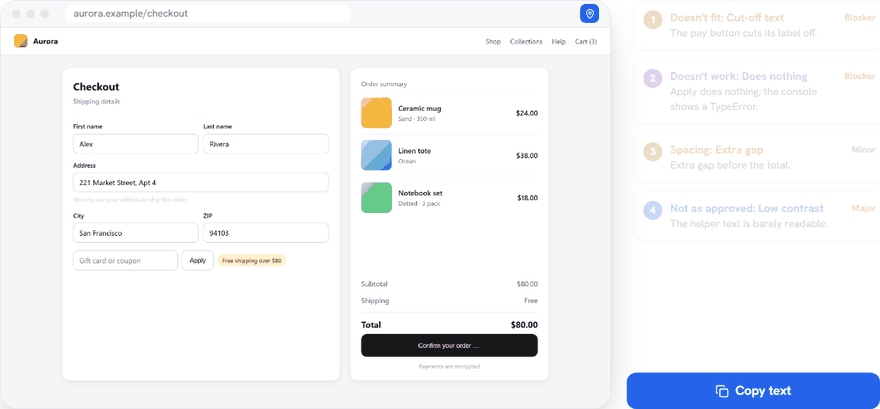
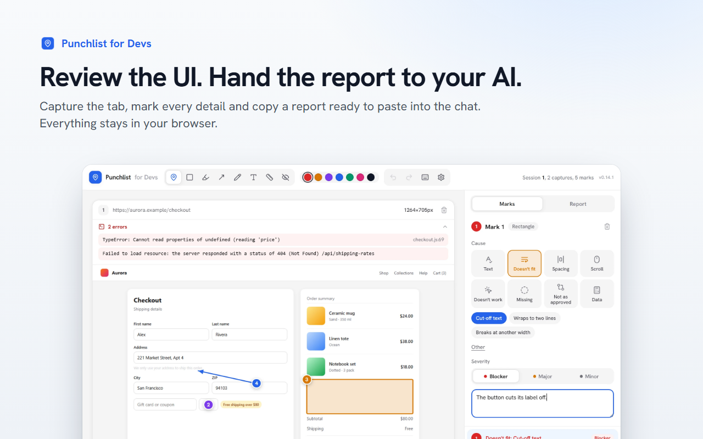
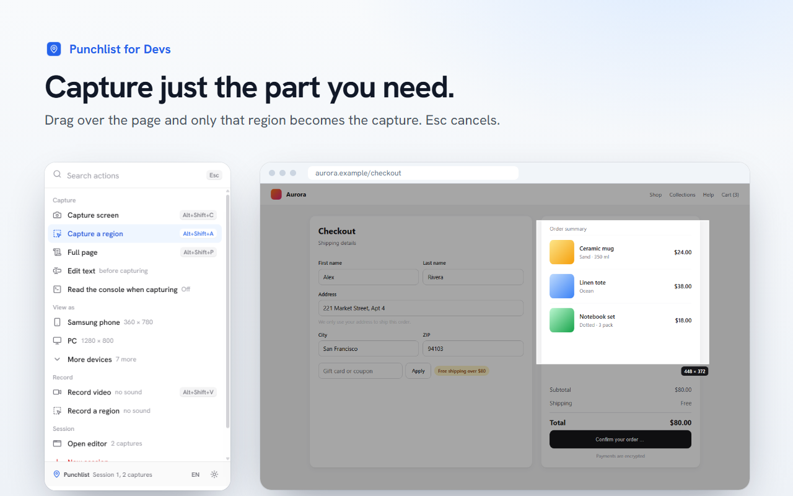
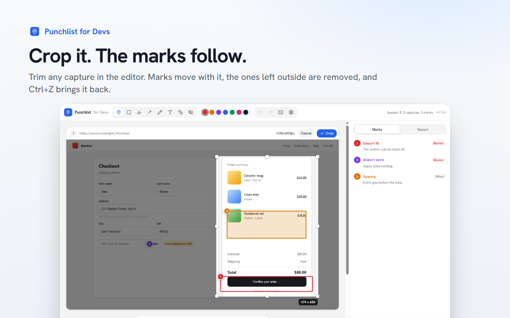
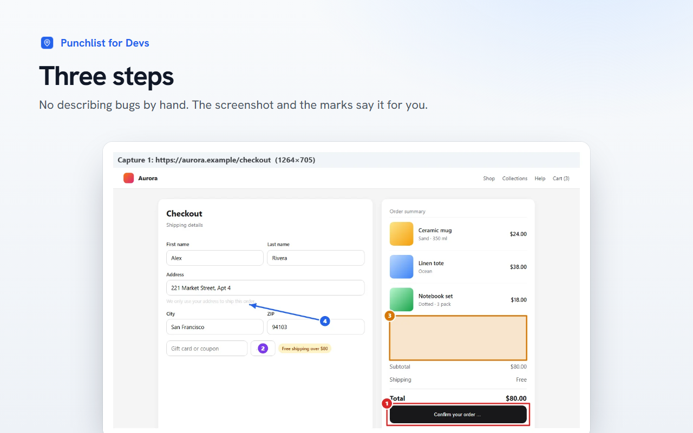
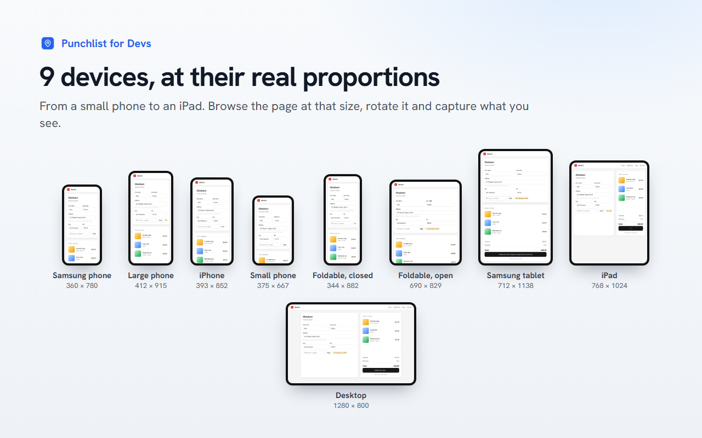
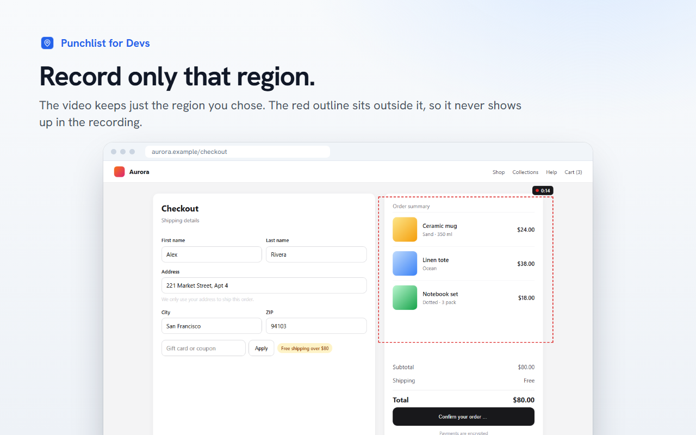
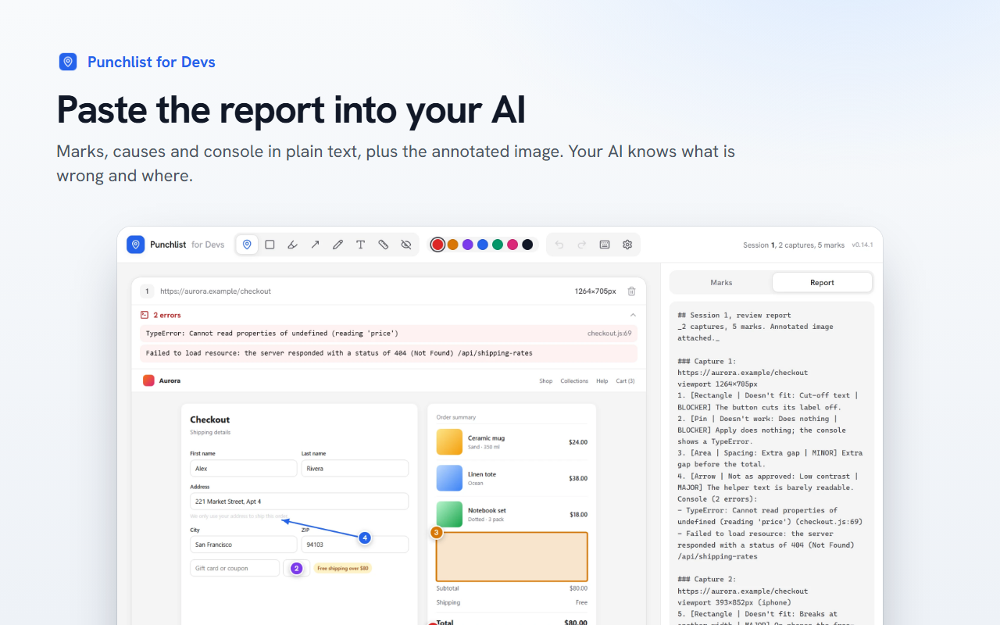

**English** | [Español](README.es.md) | [Français](README.fr.md)

# Punchlist for Devs

**Review the UI. Hand the report to your AI.**

Capture the tab, mark every detail and copy a report ready to paste into Claude, ChatGPT, Cursor or an issue. 
Everything stays in your browser.

[Website](https://usepunchlist.vercel.app) | [Privacy](https://usepunchlist.vercel.app/privacidad) | [Report a bug](../../issues/new?template=bug_report.yml) | [Request a feature](../../issues/new?template=feature_request.yml)

 

## Why

Describing a UI bug in words is slow, and your AI still guesses where it is. Punchlist turns a review into something
it understands on the first try: a **screenshot with numbered marks**, each with a **cause** and a **severity**,
plus the **console errors** of the page, in plain text and as one annotated image.

No accounts, no servers, no analytics. You decide what you copy and where you paste it.

## What it does

<table>
<tr>
<td width="50%" valign="top">

### Capture what you see
The visible tab, the **full page** (it scrolls panels and modals on its own and stitches them) or **just a region**
you drag over the page.

</td>
<td width="50%" valign="top">

### Mark every detail
Eight tools: pin, rectangle, highlight, arrow, pencil, text, a **ruler in CSS pixels** and a box to hide data.
Each mark gets a cause (doesn't fit, spacing, doesn't work, missing…) and a severity.

</td>
</tr>
<tr>
<td valign="top">

### See it on 9 devices
Device mode browses the page as a phone, foldable, tablet or desktop, portrait or landscape, and you capture
exactly that view.

</td>
<td valign="top">

### Read the console
Optional: every capture brings the JavaScript errors and failed requests since the previous one. Emails, tokens
and keys are hidden automatically.

</td>
</tr>
<tr>
<td valign="top">

### Record the bug
Record the tab, or only a region, as video. Turn any frame into a capture and mark it.

</td>
<td valign="top">

### Hand it to your AI
**Copy text** gives a report with every mark, its cause, severity and the console. **Copy image** gives one
annotated sheet. Paste both into the chat.

</td>
</tr>
</table>

## A closer look

## How it works

1. **Capture.** Click the extension icon or press a shortcut on the page you are reviewing.
2. **Mark.** The editor opens with your capture. Pick a tool, draw, choose the cause and the severity.
3. **Copy.** Press **Copy text** and **Copy image**, and paste them into your AI chat or your issue tracker.

## Keyboard shortcuts

| Shortcut | Action |
|---|---|
| <kbd>Alt</kbd>+<kbd>Shift</kbd>+<kbd>C</kbd> | Capture the visible tab |
| <kbd>Alt</kbd>+<kbd>Shift</kbd>+<kbd>A</kbd> | Capture a region |
| <kbd>Alt</kbd>+<kbd>Shift</kbd>+<kbd>P</kbd> | Capture the full page |
| <kbd>Alt</kbd>+<kbd>Shift</kbd>+<kbd>V</kbd> | Record video, or stop recording |

Phone mode, desktop mode and *Record a region* have no default shortcut: assign one in
`chrome://extensions/shortcuts`. In the editor, <kbd>1</kbd> to <kbd>8</kbd> switch tools, <kbd>Ctrl</kbd>+<kbd>Z</kbd>
undoes and <kbd>?</kbd> lists every shortcut.

## Privacy

Everything stays in your browser. Captures, marks and videos live in `chrome.storage` and IndexedDB on your
computer. The extension sends **no data** to the developer or to anyone else, has no accounts, no analytics and no
ads. Read the full [privacy notice](https://usepunchlist.vercel.app/privacidad).

Why each permission is needed

| Permission | What it is for |
|---|---|
| `activeTab` | Capture the tab you invoke the extension on. |
| `tabs` | Reuse the editor tab, and read the URL and title of the captured tab for the report. |
| `scripting` | Scroll and stitch full-page captures, show the region selector, run the text-editing mode. |
| `storage`, `unlimitedStorage` | Keep the session, captures and preferences locally. Full-page captures weigh several MB. |
| `clipboardWrite` | **Copy text** and **Copy image**. |
| `debugger` | Device mode (viewport emulation) and, only if you turn it on, reading the console when you capture. |
| `tabCapture`, `offscreen` | Record the tab, or a region of it, as video. |

## Languages

English, Spanish and French, with light and dark mode. The language follows your browser and can be changed in the
popup.

## Feedback and contributing

The source code is not public yet, but there are many ways to help:

- 🐞 **[Report a bug](../../issues/new?template=bug_report.yml)**: what you did, what you expected and what happened.
- 💡 **[Request a feature](../../issues/new?template=feature_request.yml)**: tell us what slows down your UI reviews.
- 💬 **[Join the discussions](../../discussions)**: ideas, questions and how you use it with your AI.
- 🌍 **Improve a translation**, or propose a new language, with an issue.
- 🤝 **Want to collaborate on the code?** Open a discussion and introduce yourself.

You can write in English, Spanish or French.

## Roadmap

- Move and resize a mark after drawing it.
- Show the before and after of edited text right on the capture.
- Link each mark to the DOM element and its computed CSS.
- More automatic checks: buttons that wrap to two lines, low contrast.

Have an idea that should be here? [Open a discussion](../../discussions).

## Support the project

Punchlist is free. If it saves you time:

- ⭐ **Star this repo** so more developers find it.
- ✍️ **[Leave a review](https://chromewebstore.google.com/detail/punchlist-for-devs/gcffhkjonlkafgglgpfbpadoijjimeme/reviews)** on the Chrome Web Store.
- 📣 **Share it** with your team or on social media.
- ☕ **[Buy me a coffee](https://www.paypal.com/donate/?business=manuelceomx%40gmail.com&item_name=Punchlist%20for%20Devs&currency_code=USD)** with PayPal.

---

Made by **[Manuel Castellanos](https://manuelcastellanos.com.mx)** | [usepunchlist.vercel.app](https://usepunchlist.vercel.app)

Chrome and the Chrome Web Store badge are trademarks of Google LLC.

